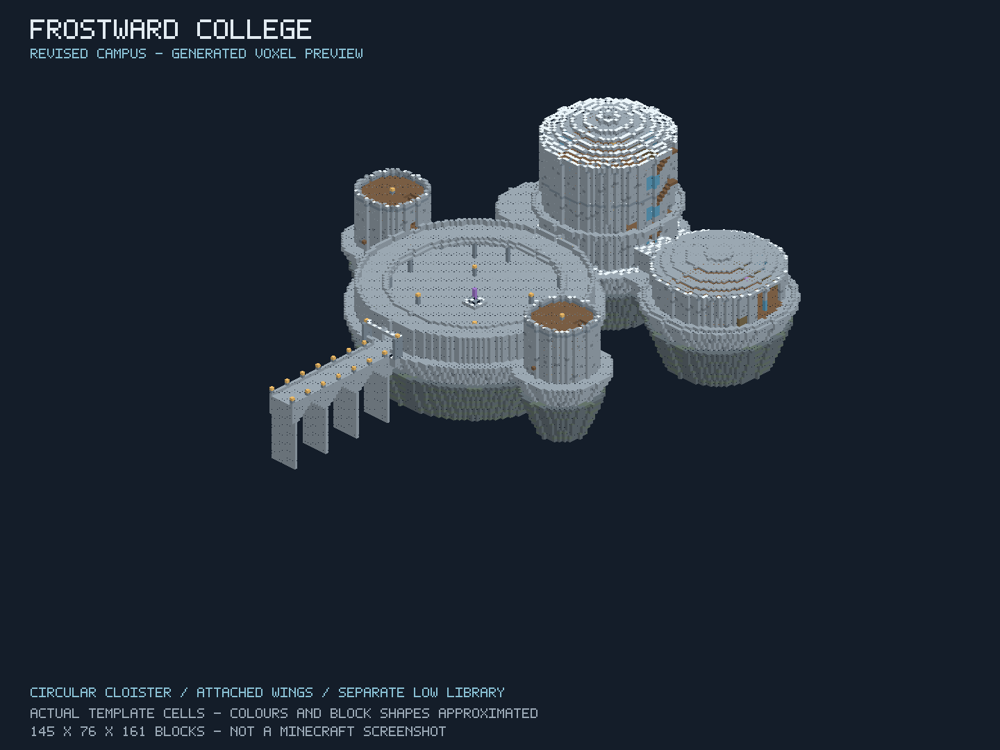
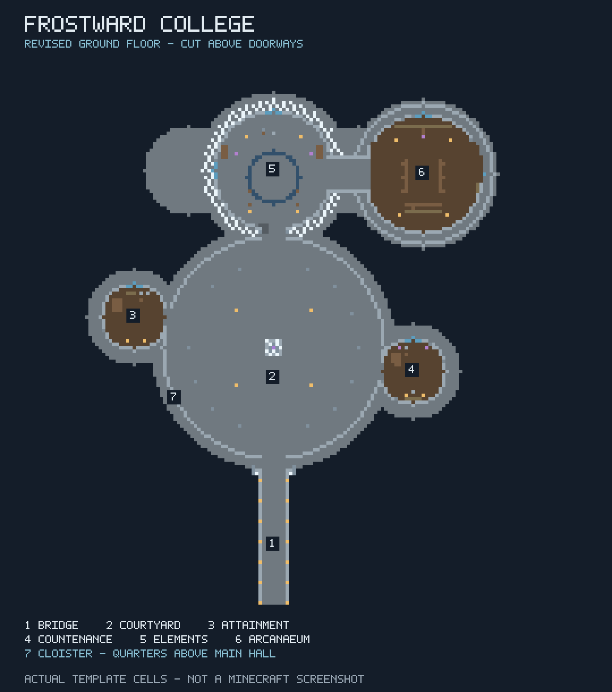

# Frostward College: Winterhold-inspired magical academy

Status: manually placeable academy with a revised circular campus and regenerated runtime template. Independent NBT/layout checks passed for this revision; Python/Gradle/Minecraft reruns are pending because the execution environment became unavailable. [Draft PR #441](https://github.com/jimbozoomer-byte/jugcraft/pull/441).

Contributor: @TwentyFiveSeconds. AI: OpenAI Codex (GPT-6), explicitly requested by the contributor. Base: upstream main at `62c32ad3a5cfa05c298eab93e978951ab351aba8`, 20 October 2026. Tier: shared magical workshop infrastructure.

## Recovery and implementation

The interrupted session left an uncommitted generator, template, five offline tests, two Java test classes, documentation and a preview on the contributor's PC. The fork branch still pointed at main. These actual files were recovered and preserved in commits `721ce826ef173f211f144c22370e7c139180d439` and `70776ad137a0b6a280e7dd49f54457ff659aa27f`, then expanded. Current main, recent commits, branches and open/closed PRs were checked; no overlapping academy was found. Open boss/factory/creature PRs are not dependencies.





These are code-rendered previews of actual NBT cells, **not Minecraft screenshots**. Colours, lighting and block shapes are approximated. The plan cuts at Y=28. Previous Blender [overview](../images/frostward-academy-overview.jpg), [section](../images/frostward-academy-cutaway.jpg) and [recovery preview](../images/frostward-academy-layout.png) show superseded layouts.

## Layout revision from contributor references

The contributor supplied two College maps after reviewing the first prototype. The revision replaces the rectangular platform with a circular enclosed court and covered annular cloister. Residential towers attach at staggered points on the rim, and their dormitory floors connect to the cloister roof walk. The bridge/gate/monument/main-hall axis remains clear. A separate low Arcanaeum wing attaches beside the main hall through a covered gallery; the former library level is now an upper teaching gallery, with Archmage quarters above it. The rocky foundation follows the joined circular footprints. Interiors, stairs, bedrooms, archive, stations and Midden components are reused.

This slice fixes the overall layout. Kitchens, baths, new lessons and NPC systems are deferred to subsequent work. It adapts the supplied maps rather than claiming an exact Skyrim reconstruction.

| Location | Implemented spaces |
| --- | --- |
| Exterior | 24-block raised rock/stone foundation following the circular campus, arched bridge and piers, entrance frame, enclosed courtyard, covered cloister/roof walk, amethyst monument, snow/weathering, battlements |
| Hall of Elements | Circular teaching chamber, demonstration ring, seats, lectern, two existing study benches, broad switchback stairs |
| Hall of Attainment | Apprentice study/storage floor, three bedrooms with doors/beds, storage and stairs to guarded roof |
| Hall of Countenance | Faculty research floor, three bedrooms, alchemy/artifice workstations, vanilla enchanting table/bookshelves and accessible guarded roof |
| Arcanaeum | Separate low wing with bookcases, reading desks/seats, special-collections enclosure and Conclave Lectern; covered connection to the main hall |
| Archmage quarters | Private sleeping/study space, storage/books, botanical garden, brewing stand and cauldron |
| Midden | Stair from the hall, branching passages, forge with furnace/anvil/unlit hearth, secret laboratory behind a door, blue-lit Augur-inspired Echo Chamber |

The bridge/court approach, hall ahead, attached residential towers, adjacent library, quarters above and passages below preserve Winterhold's broad organization. The footprint is adapted to Minecraft, not a room-for-room reconstruction. Frostward College is the Jugcraft-facing name; the stable ID is `jugcraft:academy/winterhold`.

References inspected: the labeled [College map](https://www.pinterest.com/pin/the-art-of-architecture-skyrim-architecture-college-of-winterhold--248049891953811875/) and [Winterhold maps guide](https://steamcommunity.com/sharedfiles/filedetails/?id=2564928813). Reference image bytes are not redistributed.

## Existing magic and progression

Coordinates below include the rocky base and are relative to the template origin.

| Activity | Position | Existing requirements retained |
| --- | --- | --- |
| Study / lantern work | `(57,25,28)`, `(79,25,28)` | Lampwright's Bench: specimens, tools, study time and First Light |
| Alchemy | `(113,25,85)` | Alembic Crucible: research, ingredients, water, instruments and preparation |
| Artifice | `(105,25,85)` | Artificer's Bench: research, substrates and enhancement costs |
| Enchanting | `(109,25,98)` | Vanilla equipment, lapis and experience |
| Oath / commissions | `(112,25,23)` | Conclave Lectern: First Light, rank, inventory and weekly limits |

Bring your own ingredients, instruments and learned spells. Practice in the ring and share research with the existing authored-notes system; the journal/codex remain the learning guide. Input producers are normal gathering, farming, wood/copper production and refined substrates. Research, lanterns, mixtures and equipment feed exploration, workshops and trade. Solo and teaching/trading routes remain; unrelated industry, bosses, seasons and simultaneous players are not prerequisites.

No recipe, research gate, Focus payment, quantity or conversion loss changes. No new currency, spell engine or parallel progression is added. Building materials/stations are operator-authored infrastructure, like a Creative build; repeatable survival worldgen is absent.

The placed Conclave Lectern has **no owner**. Its public oath/standing/commission interactions use `Starbound.use`; owner/party projects need a normally player-placed lectern. It fabricates no owner or first-visitor claim. See [Conclave](arcane-concordance-conclave.md), [First Light](arcane-concordance-first-light.md) and [research sharing](arcane-concordance-sharing.md).

The forge has ordinary furnace/anvil behavior, not Skyrim's summoning recipes; its campfire starts unlit. The Echo Chamber contains a sealed light, not an NPC/reward. No mobs, spawners, filled inventories, loot tables or reward scripts are generated. Instructors, scheduled lessons and quests are not implemented; existing trading professions are not a magic-instructor API.

## Manual placement

Use a disposable Creative world and a clear `145 x 76 x 161` volume. Origin is its northwest bottom corner; entry faces south at relative `(68,25,160)`. Output: **287,054 explicit blocks**, including authored air, and **53 states**. Existing blocks in rooms are replaced; the template does not clear every bounding-box cell. There is no terrain fitting, collision preflight, claim creation or undo.

For origin `0 160 0`:

```mcfunction
/forceload add 0 0 144 160
/place template jugcraft:academy/winterhold 0 160 0
/tp @s 68.5 185 160.5 180 0
/forceload remove 0 0 144 160
```

Remove the temporary forced chunks even on failure. These commands are test setup; the feature never creates chunk loaders. Walk north across the bridge, around the monument and into the hall. Main stairs connect the upper teaching gallery/quarters. The covered eastern gallery leads to the ground-floor library. The Midden stair is west of the hall entrance; passages branch to forge, lab and Echo Chamber. Both towers have bedroom and roof access. Wooden doors open by hand.

Natural generation, survival acquisition and exact [World Designer](../WORLD_DESIGNER.md) settlement placement remain future work. Current native structure pins do not place this template as a complete settlement. No custom placement command, global active-design singleton or silent chunk rewrite is added.

## Authority, persistence and performance

Stations retain existing server authority, inventory checks, processing bounds and ownership. Bench study keeps single-user ownership and pending-notes persistence. Empty storage uses vanilla access rules. Operators manage public-site protection.

Placed blocks and existing block entities save normally. No registry, attachment, save schema or released-ID rename is introduced. Concordance disable preserves saved blocks/registrations while existing logic refuses disabled activities. Template updates do not modify colleges already placed; restore a matching backup to reverse placement. No dimensions, pets, bosses or seasonal expiry are involved.

Placement writes once. No academy tick scan, network handler or entity population is added. Placement duration and multiplayer performance are unmeasured.

## Files and reproduction

- `tools/winterhold_layout.json` and `tools/winterhold_layout.py`: reviewed campus operations and assembler, reusing recovered architectural components.
- `tools/winterhold_academy.py`: deterministic original generator, using `retro_game_shop`'s writer, lowercase `id`/`properties` schema and DataVersion **5023**.
- `src/main/resources/data/jugcraft/structure/academy/winterhold.nbt`: compressed runtime template.
- `tools/test_winterhold_academy.py`: eight checks: NBT round-trip/freshness/determinism, bounds/budget, room/station access, no rewards/owners, beds/signs, doors/snow foundation and circular-footprint regression.
- `AcademyGameTests`: registered palette/property checks and placed-station integration, research refusal, paid lantern creation and Conclave oath.
- `AcademyClientGameTests`: registered placement plus eight screenshots: overview, bridge, cloister, hall, library, quarters, forge and Echo Chamber. Not run yet.
- `tools/preview_winterhold_academy.py`: optional Blender rendering, camera framing updated for the new footprint; this revision was not rendered in Blender.
- `tools/preview_winterhold_layout.mjs`: dependency-free Node NBT checks and raster previews; `node tools/preview_winterhold_layout.mjs`.
- `tools/AcademyVanillaProbe.java`: optional headless vanilla palette verification, with no mod or world launch.

```sh
python tools/winterhold_academy.py
python tools/winterhold_academy.py --check
python -m unittest discover -s tools -p test_winterhold_academy.py -v
blender --background --python tools/preview_winterhold_academy.py -- --output-dir docs/images
```

Owner-library guides/catalog and actual magic source were inspected. Already integrated station models/textures are reused unchanged; no new owner-library files are imported. Source originals/notices remain intact. Architecture, code and previews are original MIT work; no Bethesda assets or extracted geometry are included.

No dependency/platform pins changed: Minecraft 26.3, Java 25, Loader 0.19.5, Fabric API 0.161.0+26.3, Gradle 9.6.0; Loom retains the source's `1.17-SNAPSHOT`. Actual AI attribution is OpenAI Codex (GPT-6), not Claude; maintainer acceptance of the repository's model-policy exception remains for review.

## Validation and remaining work

Previous layout validation, Windows, 20 October 2026: Blender 5.2 / Python 3.13.13. Five recovered tests passed before expansion; **seven expanded academy tests passed before this layout revision**. The navigation model checks two-block headroom/one-block steps, hand-openable wooden doors and passable thin snow. It reaches all six bedrooms, upper battlements, balconies, archive and underground rooms. It does not simulate exact Minecraft collision.

**Six client-test selection regressions** and **eleven World Designer model/compiler regressions** pass. The repository structure/link check passes with a Windows path-normalization wrapper for long catalog paths; its assertions were unchanged. Both architectural previews were rendered and visually inspected. The full material-data audit was attempted after restoring source assets and supplying its existing DejaVu font dependency. It did not finish after an extended local run and was stopped without a result: **incomplete, not passed**. CI must rerun it.

The installed vanilla Minecraft **26.3** JAR and its 75 available launcher libraries were also loaded by Microsoft Java **25.0.1**. `AcademyVanillaProbe` bootstrapped the real vanilla registries and read the generated NBT: **49 vanilla palette states passed** ID/property/value validation; **four Jugcraft states were explicitly skipped**. DataVersion was 5023. This is not Jugcraft compilation, structure placement, server GameTests or a client launch. To reproduce, use Java 25 with the installed vanilla 26.3 launcher's complete classpath:

```sh
java --class-path "<vanilla-26.3-launcher-classpath>" tools/AcademyVanillaProbe.java src/main/resources/data/jugcraft/structure/academy/winterhold.nbt
```

A local Microsoft JDK **25.0.1** was found. `gradlew.bat build --no-daemon` stopped before compilation with `java.net.UnknownHostException: services.gradle.org` fetching Gradle. Upstream Build/Foundation runs report `action_required`: a maintainer must approve fork CI. The upstream workflow is unchanged. Neither is a passing Minecraft result.

Current layout revision: the shell/runtime environment reports **No usable execution environment is available**. The saved generator's eight Python tests, Gradle compilation, Blender rerender and all Minecraft tests therefore have **not been rerun**. No CI workflow was added or changed to work around this.

The runtime template was regenerated through the same declarative operations applied to the preserved prior NBT. An independent JavaScript NBT reader/writer checked compression CRC, primitive round-trip, bounds/uniqueness, all six station positions, 31 room/walkway points using the existing navigation model, eight complete doors, 14 bed halves, eight supported signs, 753 supported snow layers, no inventories/owners/entities, a single Conclave Lectern, the circular footprint and separate library roof. All passed. All 53 palette states are identical to the previous template's states; the earlier vanilla-only palette probe still is not a mod runtime placement test. The two current PNGs were generated from those actual cells and visually inspected.

NBT freshness compares decompressed content, allowing standard gzip encoders to produce different compressed streams without changing the authored template. The canonical Python build still uses the shared writer. CI must verify its generated content equals the committed resource.

Remaining acceptance work:

1. Approve CI, compile, run server GameTests and `AcademyClientGameTests`, inspect actual screenshots and fix exposed registry/model/collision issues; run optional-integrations-absent coverage.
2. Walk every stair/door; use study, spell practice, alchemy, enchanting, artifice and the lectern. Test two users, concurrent benches, reconnect/restart with active study, disable behavior and placement timing.
3. Review proportions in-game; voxel previews cannot certify appearance.
4. Future slices: terrain-aware survival/worldgen, supported World Designer integration, instructors/curriculum/quests and authored hazardous encounters. No unmerged API is assumed.

A real academy implementation is saved for review and manual placement after building. Runtime certification and those later school systems remain outstanding.

