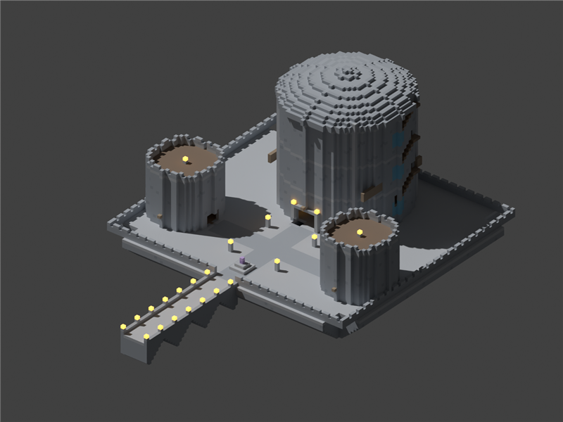

# Frostward College: Winterhold-inspired academy prototype

Status: implemented structure prototype; local offline checks passed; Minecraft build and playtests unverified.
Proposal issue: none; this contribution proposes the feature directly.
Contributor: @TwentyFiveSeconds. AI assistance: OpenAI Codex (GPT-6), at the contributor's request.
Base: upstream `main` at `62c32ad3a5cfa05c298eab93e978951ab351aba8` (20 October 2026).
Tier: shared workshop infrastructure; the existing Concordance research gates still apply to each activity.

## Player experience

Explore a furnished magical academy with a stone entrance bridge, raised courtyard, circular Hall of Elements,
Arcanaeum library, archmage study, two residential/workshop towers and an accessible undercroft. Study specimens at
two existing Lampwright's Benches, prepare mixtures at the existing Alembic Crucible, or use the existing Artificer's
Bench. Bring your own ingredients and tools. The structure contains no free spells, research, filled inventories,
bosses, spawners or reward scripts. The Conclave's teaching/notes system remains available normally; this prototype
does not introduce teachers, lessons or a separate academic currency.

This is an original Minecraft build inspired by the College of Winterhold's broad architectural organization. It is
not a room-for-room reconstruction of Skyrim. Frostward College is the proposed Jugcraft-facing name; the resource
identifier is `jugcraft:academy/winterhold`.



The preview is a Blender view of the actual generated block coordinates, **not an in-game screenshot**. All block
shapes are simplified to cubes, materials are flat colours, and the existing stations appear as coloured cubes.
It verifies the broad silhouette and layout, not textures, block models, lighting or exact collision geometry.

## Try it in a disposable local world

Build the mod with the repository's existing pinned toolchain. Start a new Creative test world with commands enabled,
away from structures or player builds. This first slice uses Minecraft's existing operator-only template placement;
it adds no custom placement command or automatic worldgen.

1. Choose a clear `97 × 60 × 121` block volume. The origin is its northwest bottom corner; the entrance faces south.
   Explicit air in the rooms replaces existing blocks. There is no preflight collision check, undo, terrain fitting,
   ownership assignment or claim creation. Use a disposable world; this is not a live-server installation procedure.
2. For an origin at `0 160 0`, load the area, then place the resource:

   ```mcfunction
   /forceload add 0 0 96 120
   /place template jugcraft:academy/winterhold 0 160 0
   /tp @s 48.5 169 120.5 180 0
   /forceload remove 0 0 96 120
   ```

   The temporary chunk-load commands are only a manual test setup; the feature never adds a chunk loader. Remove
   those same chunks if placement fails. Do not change world height or overwrite a real build to fit the prototype.
3. Walk north over the bridge, around the courtyard crystal, into the hall and up the broad switchback staircases.
   The undercroft flight is just west of the hall entrance. The tower stairs lead to the furnished dormitories.
4. Use the bench at relative `(37,9,24)` or `(59,9,24)` with your own specimens and lantern. Existing First Light
   research must be learned normally; see the [first-light route](arcane-concordance-first-light.md).
5. The west tower holds the Crucible at `(22,9,54)`; the east tower the Artificer's Bench at `(74,9,54)`.
   Their normal tools, research, consumables and permission checks apply.

No new crafting recipe is needed to make the building a runtime structure resource. Survival acquisition of the
whole college, natural generation and exact placement from [World Designer](../WORLD_DESIGNER.md) are future work.
World Designer's existing native structure pins do not currently place this template as a complete settlement.

## Connections, progression and balance

- Input producers: existing specimen gathering, farming, copper/wood production, alchemical ingredients and refined
  artifice substrates. Players supply these through the normal systems; no ingredient is created by a school script.
- Output consumers: existing research, lighting, prepared mixtures and crafted equipment, useful in exploration,
  workshops and trade. The library/dormitories provide shared building space, not an extra progression ladder.
- Required connection: existing Concordance workstations and research. Factories, bosses, other schools, multiplayer
  partners and seasonal events are not prerequisites. Established solo and teaching/trade routes are preserved.
- Existing recipes, quantities, Focus spending, study duration and conversion losses are unchanged. The campus is
  operator-authored infrastructure, so its placed building materials/stations are free in the same sense as any
  Creative build; it is intentionally not enabled as repeatable survival worldgen or a player summon item.
- No new resource, registry, dependency, networking protocol, reward or energy conversion is introduced.

## Files and integration

- `tools/winterhold_academy.py`: original deterministic voxel generator. Reuses `retro_game_shop.state`,
  `retro_game_shop.nbt_bytes` and its **26.3 DataVersion 5023**, including lowercase `id`/`properties` palette entries.
- `src/main/resources/data/jugcraft/structure/academy/winterhold.nbt`: compressed game-usable structure resource.
  Size `97 × 60 × 121`, 110,931 explicit blocks (including air), 29 states. Only the platform, buildings and bridge
  are authored; no bounding-box-wide terrain replacement is performed.
- `tools/test_winterhold_academy.py`: NBT round trip, deterministic output, committed output freshness, bounds,
  block count budget, station IDs, no reward/owner data, bed/sign support and room/station accessibility.
- `AcademyGameTests`: runtime registry/property checks and template placement with existing station block entities,
  research refusal and a paid lantern working. Registered in the existing GameTest manifest.
- `AcademyClientGameTests`: template placement and overview, bridge, hall and library screenshots in a disposable
  Creative client world. Registered alongside existing client tests.
- Build workflow: two narrow offline checks added; all existing build, data, optional-absence and client checks retained.

## Multiplayer, persistence and performance

All gameplay remains in the existing server-authoritative station implementations. Bench studies keep their normal
single-user ownership, inventory and pending-notes persistence; no client can grant knowledge or bypass ingredient
costs by entering the building. Artifice uses the player's existing research. Empty barrels provide ordinary shared
storage, with vanilla interaction rules. No claim/protection is created automatically. Server operators must manage
public-site access through their existing policy and protection systems.

The placed college is ordinary saved world blocks, plus existing block entities. No new save schema or player
attachment is introduced, and no existing ID is renamed. Disabling Concordance retains registered blocks and saved
data while its existing station logic refuses disabled activities. Removing the template from a datapack does not
erase already placed buildings. Regenerating the template does not edit any world or silently upgrade an existing
college. Normal backup/restore remains the way to reverse manual placement.

There is no per-tick academy system, scan, network request, reward loop or automatic chunk loading. Placement writes
110,931 blocks once and may cause a noticeable pause; no timing or multiplayer performance claim has been measured.
The four existing stations retain their own bounded tick behavior. This is permanent content; no seasonal expiry or
earned seasonal content is changed. No dimensions, return travel, pets or boss containment are involved.

## Dependencies and provenance

No dependency or platform pin changed. Read directly from current source: Minecraft 26.3, Java 25, Fabric Loader
0.19.5, Fabric API 0.161.0+26.3, Gradle 9.6.0; Loom's source pin remains `1.17-SNAPSHOT` (the platform document records
the previously resolved `1.17.21`). Existing framework releases remain owned by the shared lock.

The owner-library guides/catalog and existing runtime magic blocks were inspected. This contribution reuses those
already integrated workstations, models and textures; it imports no additional library assets. The architecture and
generator are original to this contribution under the repository's MIT license. User-supplied College of Winterhold
screenshots/maps are design references only and are not redistributed. No Bethesda assets, sounds, textures, names
of Skyrim characters or extracted geometry are included. Image-byte retrieval was unavailable locally, so the
reference images were not visually inspected in this implementation environment; the labeled room list was readable.

## Verification actually performed

Local PC, Windows, Python 3.13.13 from the installed Blender 5.2 runtime:

```sh
python tools/winterhold_academy.py
python tools/winterhold_academy.py --check
python -m unittest discover -s tools -p test_winterhold_academy.py -v
```

The generator and all five offline tests passed. The navigation check caught and prompted fixes to the upper
stairwell landings and an undercroft stair opening overwritten by the hall floor. It models two-block headroom and
one-block steps; it does not implement Minecraft's exact slab/stair collision or a human walking test.

A flat-colour layout preview was rendered in Blender and visually inspected. `gradlew.bat build` was attempted and
stopped before compilation: `JAVA_HOME is not set and no 'java' command could be found in your PATH.` Git clone also
failed (`getaddrinfo() thread failed to start`), so the local workspace holds only a source subset fetched through the
GitHub connection. `python scripts/check_repository.py` was attempted and failed on missing files/linked documents
in that incomplete checkout. This is not evidence that those upstream files are absent. The full data audit was not run.

**Not run:** compilation, server GameTests, client GameTests/in-game appearance, manual walking/casting, two-client
dedicated-server use, reconnect/restart, optional-integrations-absent build, save migration or placement timing.
The Java tests are provided for CI/maintainer review; their presence is not a passing result. Retain Draft status
until the build/tests and the following playtests have actually run.

## Remaining work

1. Build and run the added server/client tests on the exact platform; inspect the resulting screenshots and repair
   any schema, lighting, collision or rendering issues. Repeat offline checks after changing the generator.
2. Walk every stair and doorway; try study, lantern creation, alchemy and artifice; test two users and restart the
   world with an active study. Confirm work costs and existing claim/protection behavior.
3. Review the silhouette, proportions and room layout with the contributor before further detailing. The current
   design is a first academy build, not a visually verified recreation of the supplied references.
4. Separately design survival/world-generation placement, terrain support and World Designer integration. Teachers,
   schedules, curriculum, school-specific rooms, Conclave lectern ownership and quests are not implemented here.
5. Actual AI attribution is OpenAI Codex (GPT-6). Repository-default Claude Opus 5.5 attribution is not claimed;
   maintainer acceptance of the model-policy exception remains for review.
